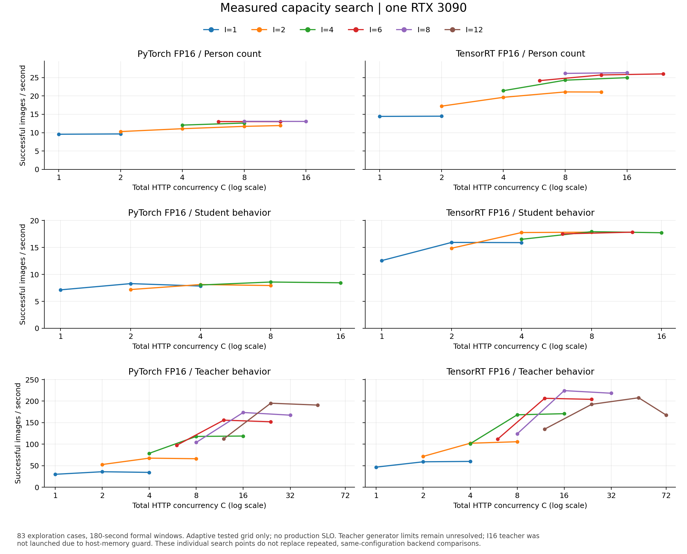
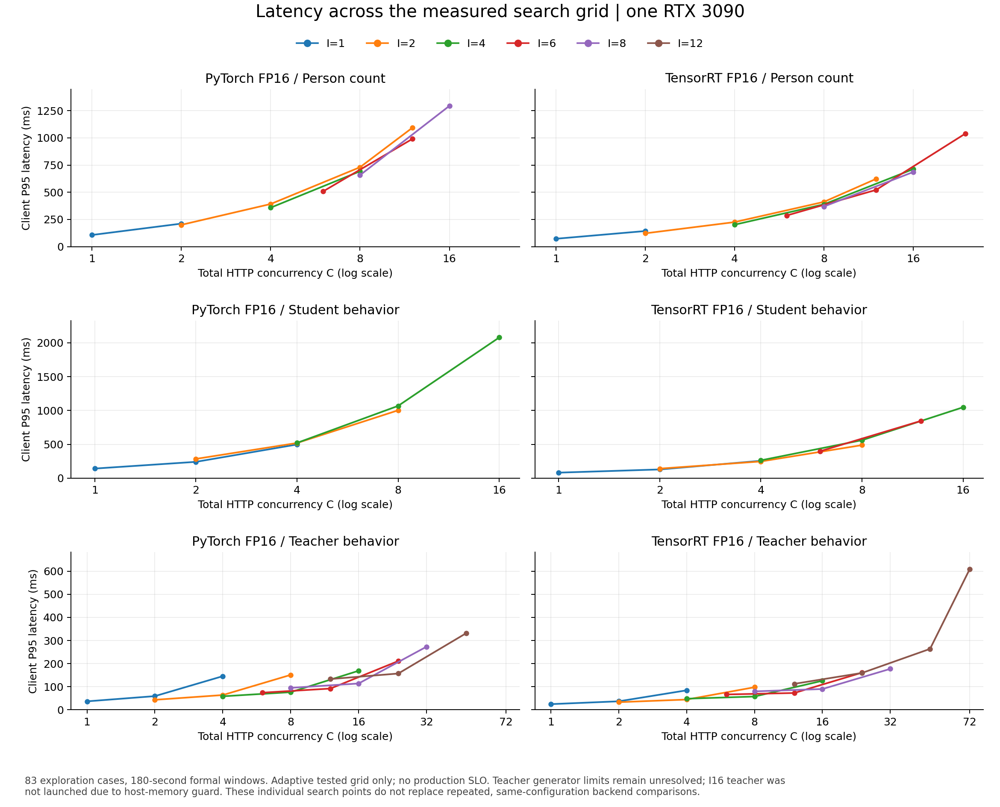
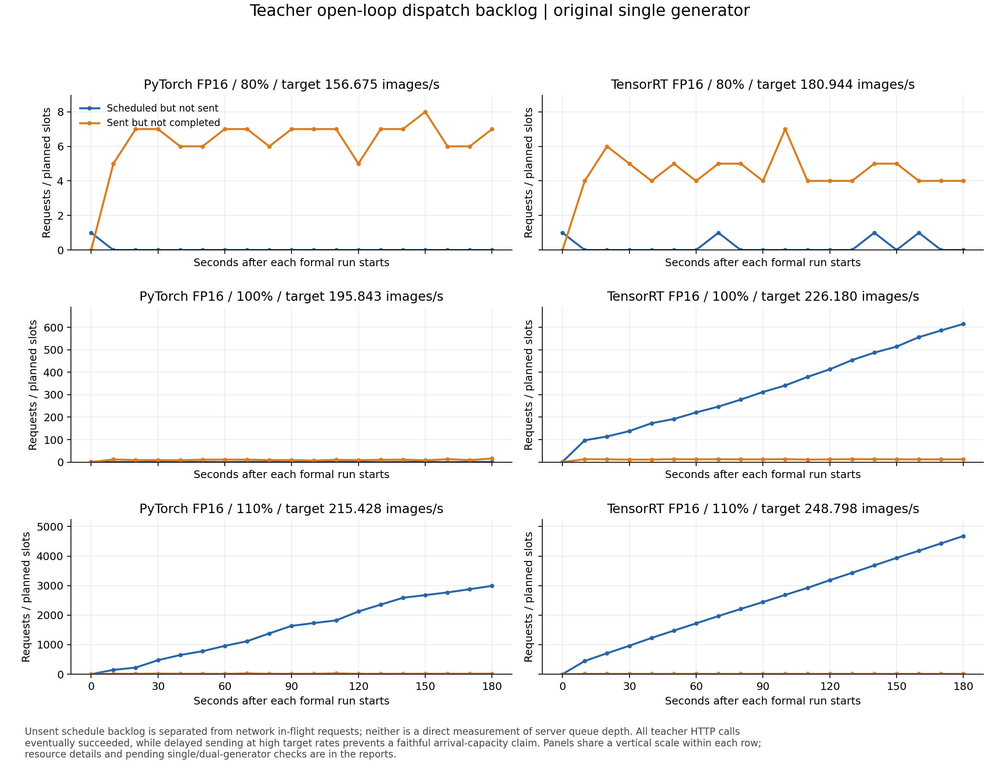
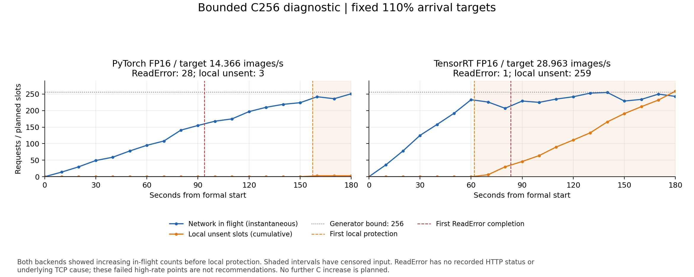

# 原始容量阶段图表

状态：已从原PT69轮/TRT74轮及两次C256补证的已核验摘要生成四幅图并完成视觉核查。当前固定配对18组以及后续单双发生器、审计/trace等结果不在本版中；不是最终增益或生产容量结论。

## 输入与复现

制图直接校验四个输入摘要SHA，分别为PT全量91bb5eff1afdc3e622bf34c2e71fa83b7a108abca4a561b0f2256bc4395ac72d、TRT全量10693fbcc95f0e9c0f2345262baf5c61e7d46f59f5b98578d261338a737ce9a5、PT C256 fc3a69e4b64def24885a895a9c423c87b2d126b82186becb7c11cd20b914819c、TRT C256 a6d5e31beeaed9975925893436d4d234b9f26b2c46445b4df884e45c098d1593。输入均来自本机已核验的私有备份，没有重新运行模型或改动原记录。

145条聚合指标见[数据表](case-metrics.csv)，保留全部143轮和2补证；其中83个探索点绘制搜索曲线。failed_slots包含发生器本地未发槽，不能当作服务HTTP失败数；失败明细和计数分母见各接口及C256报告。GPU利用率不等于FLOPS利用率，各曲线连线仅辅助阅读，不对未测点赋予容量值。

使用独立本机Python3.12.9制图环境/Users/zhangshen/.codex/venvs/vbas-benchmark-plots-20261119，Matplotlib3.9.4，完整锁定清单见[requirements.txt](requirements.txt)。没有更改服务器vbas/vbas-trt或原jy-tias。代码[plot.py](plot.py)、输入/产物清单[manifest.json](manifest.json)、[checksums.json](checksums.json)、[QA记录](qa.json)已保留。

复现时在/Users/zhangshen/.codex/backups/vbas-benchmark-20261118/下新建独立输出子目录，将本报告的plot.py复制到该目录后用上述环境执行。脚本以所在目录为输出、其父目录为备份输入根，逐一核对上述输入哈希；已有产物拒绝覆盖。跨环境复现仍须核查字体和布局，不能仅凭数值相同忽略展示错误。

首版r1的共享纵轴范围提前冻结，导致右列部分曲线裁剪，已明确拒绝使用并保留在私有备份。r2从两后端全部点计算每行公共范围，断言每幅搜索图83个点均在坐标范围内，并逐幅视觉核对标题、单位、曲线、图例和范围。交付r3对SVG行尾空白及CSV换行作规范化；四幅PNG逐字节与已视觉核查r2相同，SVG的XML标签/文本和归一化属性逐项相等，145行CSV值与r2相等。原始数值未改变。

本机capacity-figures-20261119-r3/evidence.tar.gz含13份图表/数据/代码/依赖/QA文件，973868字节、SHAd28bc3ef4a3a105f93c460c2dea6660538d595762aa8e53af0dbd3593b0441e3，已整包及全部成员核验。该派生图包尚未上传服务器；待当前固定配对完成后连同后续新版本图表归集。Git只保存这些不含照片、完整配置或逐图响应的聚合材料。

## 搜索吞吐与时延

两后端同一接口共用相同纵轴，横轴为总C的对数刻度；I表示实例数。这里只显示原始180秒探索点，三轮确认/稳定性与同配置正式比较另行报告。教师发生器限制尚未排除，I16被主机内存保护跳过，不能称图中最高点为绝对服务峰值。

矢量导出：[吞吐SVG](search-throughput.svg)、[时延SVG](search-latency-p95.svg)。

## 教师开放式发送端积压

蓝线是已计划但未发送，橙线是已发送尚未完成，二者都不是直接测得的服务内部队列。各面板从本轮正式起点计时，并非同一个绝对实验窗口；同一行纵轴相同。TRT100%以及两端110%的未发增长，说明最终HTTP全部成功不足以证明目标到达率被忠实施加。

矢量导出：[教师积压SVG](teacher-open-backlog.svg)。

## 人数C256有界补证

蓝线为实际在途瞬时值，橙线为本地未发累计槽；虚线分别表示256上限、首次本地保护与首次ReadError完成时刻。阴影区输入已被本地保护截断。两端都在保护前出现持续在途增长，高定速点不推荐，不能用本图确定底层TCP根因或继续无界增压。

矢量导出：[C256积压SVG](sync-c256-backlog.svg)。
