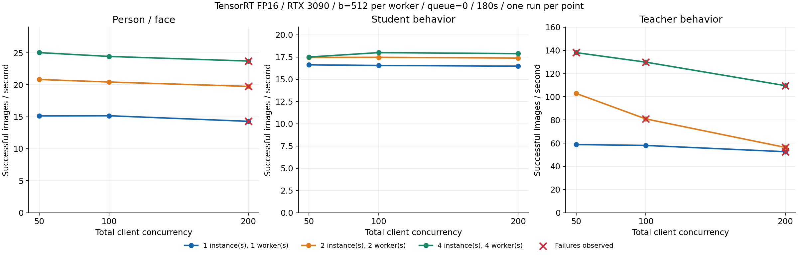
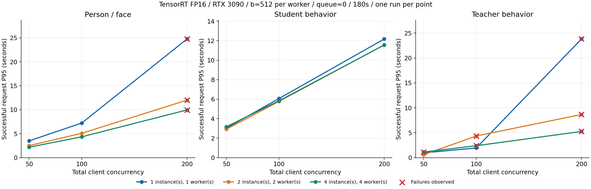
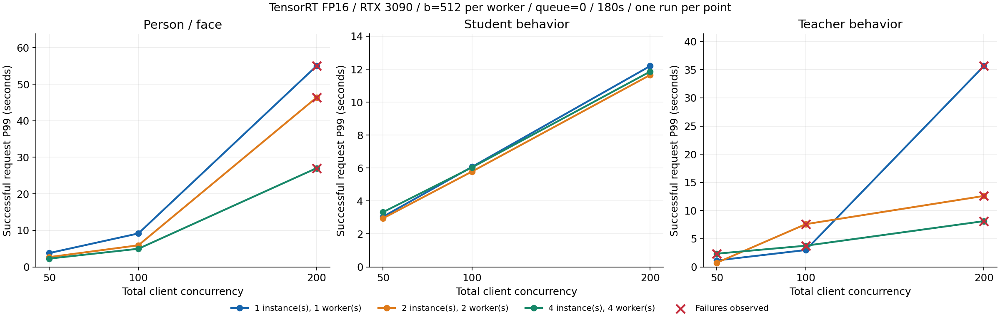
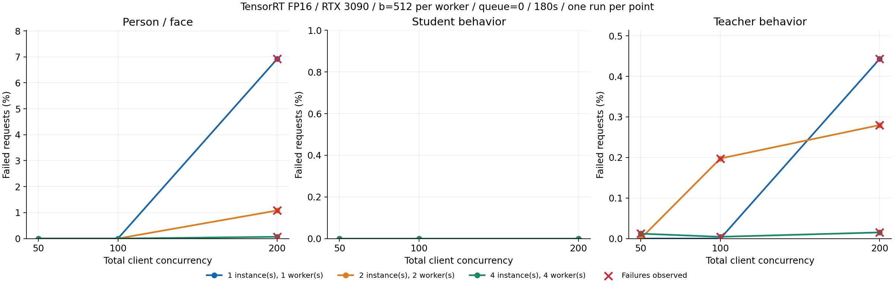
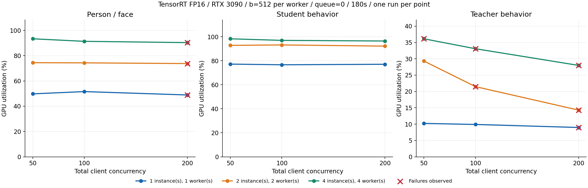
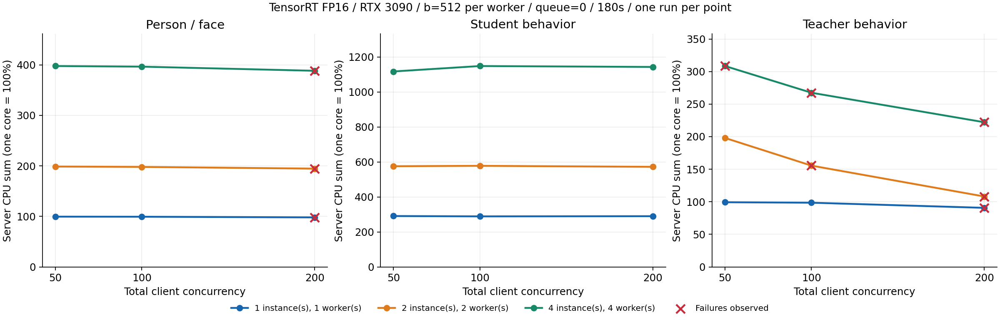

# RTX3090三接口27轮并发与实例拐点报告

待确认事项：原协议所列外层管理脚本CPU/RSS没有采样；27轮已执行数据及报告照常完成，但该资源范围的完成出口仍待用户确认，不能称全部协议项通过。

正式窗口首起点（北京时间）2026-11-20T23:56:53+08:00，末轮排空结束约2026-11-21T01:56:29+08:00；此时间范围包含阶段间调查/等待，不把间隔计入吞吐分母。报告生成时间2026-11-21T02:05:01+08:00。
状态：27个约定窗口全部执行、原始统计/资源/清理核对及完整本机备份完成。最终成功204938次、失败358次；失败点保留，不把工作完成写成27轮全部零失败或生产验收通过。

## 用户确认的条件

三个接口分别单独测试，每接口I1/2/4 × 总客户端C50/100/200共9轮，合计27轮；每实例W1、worker总数1/2/4。用户明确每worker MaxConcurrentBatches=512，MaxQueueSize=0。四模型均在worker就绪前加载、warmup；每个窗口仅调用一个接口，不做混合业务。

服务器冻结代码3f77bfdcb197fd7bb957e45104342389ed3daca7，唯一物理GPU1 RTX3090 UUID GPU-8c6b7efd-2b4f-04f3-db71-b50d2482fc49，项目model/同SHA四Engine、FP16、batch1；不改模型/阈值/NMS/业务/运行库，不部署。输入沿用完整池sync/student2162、teacher1577张，一请求一图、Base64、seed20261118。每轮全部实例就绪后30秒预热、180秒正式发送、HTTP timeout60秒、停止发送后排空、无重试/trace。

SyncTasks2现有路由不经BatchAdmissionController，因此b512不对其形成准入约束；师生接口经过controller.admit，b512对它们生效。queue0不等于没有HTTP、事件循环、线程池或模型锁等待；客户端C也不是Engine batch或单worker GPU并发数。

多实例使用既有load.py固定客户端worker到端口的调度，直连独立loopback端口，不引入Nginx或生产网关。I4/C50各端口并发为13/13/12/12，其他可整除组合均匀；keepalive及图片处理差异影响各实例实际请求频次，分布保留在summary。

## 统计口径

成功图/s只统计正式180秒内完成且HTTP/业务成功的图片，排空后成功不回填窗口。成功延迟来自正式发送的所有成功请求，含窗口后排空；失败延迟单列。正式资源按同一绝对起点/窗口过滤，服务CPU和RSS是逐采样时刻所有实际worker之和，CPU按单核100%计，不是整机百分比。成功HTTP字段检查不等同逐条检测框/准确率审计，本轮不作该声明。

## 全部27轮结果

| 接口 | I/W总数 | C | 已发 | 最终成功 | 失败 | 窗口成功图/s | 成功P50/P95/P99（秒） | GPU均值 | GPU峰值MiB | 服务CPU均值 | 服务RSS峰值MiB |
|---|---:|---:|---:|---:|---:|---:|---|---:|---:|---:|---:|
| 人数/人脸 SyncTasks2 | 1 | 50 | 2775 | 2775 | 0 | 15.139 | 3.241/3.501/3.793 | 49.79% | 1571 | 99.46% | 1913 |
| 人数/人脸 SyncTasks2 | 1 | 100 | 2829 | 2829 | 0 | 15.161 | 6.509/7.221/9.154 | 51.58% | 1571 | 99.30% | 2259 |
| 人数/人脸 SyncTasks2 | 1 | 200 | 2978 | 2772 | 206 | 14.289 | 7.000/24.752/54.973 | 48.91% | 1571 | 97.98% | 2902 |
| 人数/人脸 SyncTasks2 | 2 | 50 | 3800 | 3800 | 0 | 20.833 | 2.391/2.511/2.688 | 74.44% | 3138 | 198.62% | 3461 |
| 人数/人脸 SyncTasks2 | 2 | 100 | 3779 | 3779 | 0 | 20.439 | 4.823/5.084/5.915 | 74.31% | 3138 | 197.91% | 3820 |
| 人数/人脸 SyncTasks2 | 2 | 200 | 3796 | 3755 | 41 | 19.750 | 8.480/12.004/46.337 | 73.75% | 3138 | 194.52% | 4548 |
| 人数/人脸 SyncTasks2 | 4 | 50 | 4556 | 4556 | 0 | 25.033 | 1.985/2.180/2.273 | 93.34% | 6273 | 397.61% | 6620 |
| 人数/人脸 SyncTasks2 | 4 | 100 | 4499 | 4499 | 0 | 24.439 | 4.048/4.346/4.963 | 91.33% | 6273 | 396.37% | 6931 |
| 人数/人脸 SyncTasks2 | 4 | 200 | 4472 | 4469 | 3 | 23.717 | 8.168/9.950/27.011 | 90.32% | 6273 | 388.20% | 7670 |
| 学生行为 | 1 | 50 | 3043 | 3043 | 0 | 16.628 | 3.001/3.024/3.048 | 77.23% | 1611 | 290.70% | 2519 |
| 学生行为 | 1 | 100 | 3080 | 3080 | 0 | 16.556 | 6.019/6.063/6.074 | 76.68% | 1611 | 288.74% | 2870 |
| 学生行为 | 1 | 200 | 3166 | 3166 | 0 | 16.478 | 12.055/12.173/12.192 | 77.09% | 1611 | 289.77% | 3571 |
| 学生行为 | 2 | 50 | 3193 | 3193 | 0 | 17.461 | 2.855/2.917/2.949 | 92.84% | 3218 | 575.40% | 4692 |
| 学生行为 | 2 | 100 | 3245 | 3245 | 0 | 17.472 | 5.711/5.769/5.791 | 93.21% | 3218 | 577.62% | 5034 |
| 学生行为 | 2 | 200 | 3330 | 3330 | 0 | 17.389 | 11.419/11.571/11.650 | 92.23% | 3218 | 571.91% | 5730 |
| 学生行为 | 4 | 50 | 3201 | 3201 | 0 | 17.506 | 2.825/3.170/3.323 | 98.33% | 6433 | 1116.94% | 9011 |
| 学生行为 | 4 | 100 | 3340 | 3340 | 0 | 18.000 | 5.517/5.833/6.041 | 97.01% | 6433 | 1148.01% | 9359 |
| 学生行为 | 4 | 200 | 3420 | 3420 | 0 | 17.889 | 11.053/11.556/11.856 | 96.48% | 6433 | 1142.73% | 10038 |
| 教师行为 | 1 | 50 | 10627 | 10627 | 0 | 58.761 | 0.874/0.954/1.142 | 10.22% | 1571 | 99.29% | 1628 |
| 教师行为 | 1 | 100 | 10541 | 10541 | 0 | 58.006 | 1.741/1.937/2.994 | 9.90% | 1571 | 98.57% | 1644 |
| 教师行为 | 1 | 200 | 9710 | 9667 | 43 | 52.594 | 1.345/23.816/35.653 | 8.98% | 1571 | 90.69% | 1668 |
| 教师行为 | 2 | 50 | 18566 | 18566 | 0 | 102.867 | 0.498/0.583/0.738 | 29.32% | 3138 | 197.98% | 3248 |
| 教师行为 | 2 | 100 | 14687 | 14658 | 29 | 80.878 | 0.772/4.339/7.587 | 21.48% | 3138 | 155.52% | 3263 |
| 教师行为 | 2 | 200 | 10362 | 10333 | 29 | 56.294 | 2.862/8.660/12.592 | 14.29% | 3138 | 108.12% | 3280 |
| 教师行为 | 4 | 50 | 24902 | 24899 | 3 | 138.050 | 0.235/1.129/2.348 | 36.13% | 6273 | 308.44% | 6488 |
| 教师行为 | 4 | 100 | 23471 | 23470 | 1 | 129.833 | 0.436/2.391/3.762 | 33.08% | 6273 | 267.43% | 6486 |
| 教师行为 | 4 | 200 | 19928 | 19925 | 3 | 109.583 | 1.255/5.254/8.122 | 27.98% | 6273 | 222.15% | 6504 |

## 发生器、覆盖与排空补充

| 组合 | 发生器CPU均值（单核100%） | 发生器RSS峰值MiB | GPU均温/均功耗 | 正式资源样本 | 覆盖图/池 | 窗口末在途 | 排空秒 | 失败P95秒 |
|---|---:|---:|---|---:|---|---:|---:|---:|
| sync-i1-w1-c50-b512 | 9.49% | 1096.6 | 76.7°C / 291.1W | 180 | 2162/2162 | 50 | 1.149 | — |
| sync-i1-w1-c100-b512 | 13.97% | 1239.2 | 79.2°C / 292.9W | 180 | 2162/2162 | 100 | 5.114 | — |
| sync-i1-w1-c200-b512 | 15.46% | 1365.1 | 78.4°C / 289.3W | 179 | 2162/2162 | 200 | 17.453 | 65.172 |
| sync-i2-w1-c50-b512 | 12.06% | 1100.5 | 79.4°C / 321.8W | 180 | 2162/2162 | 50 | 1.281 | — |
| sync-i2-w1-c100-b512 | 14.22% | 1270.6 | 81.2°C / 320.5W | 180 | 2162/2162 | 100 | 2.713 | — |
| sync-i2-w1-c200-b512 | 20.84% | 1598.1 | 81.3°C / 318.5W | 180 | 2162/2162 | 200 | 6.388 | 66.020 |
| sync-i4-w1-c50-b512 | 13.67% | 1097.0 | 81.6°C / 342.7W | 180 | 2162/2162 | 50 | 1.528 | — |
| sync-i4-w1-c100-b512 | 16.02% | 1346.8 | 83.6°C / 339.3W | 180 | 2162/2162 | 100 | 2.302 | — |
| sync-i4-w1-c200-b512 | 21.13% | 1643.6 | 83.6°C / 336.0W | 180 | 2162/2162 | 200 | 5.494 | 4.671 |
| student-i1-w1-c50-b512 | 10.55% | 1096.5 | 82.2°C / 327.5W | 180 | 2162/2162 | 50 | 2.977 | — |
| student-i1-w1-c100-b512 | 11.88% | 1324.0 | 81.7°C / 323.3W | 180 | 2162/2162 | 100 | 5.946 | — |
| student-i1-w1-c200-b512 | 12.74% | 1491.9 | 81.6°C / 324.3W | 179 | 2162/2162 | 200 | 11.970 | — |
| student-i2-w1-c50-b512 | 11.46% | 1112.2 | 83.8°C / 339.9W | 180 | 2162/2162 | 50 | 2.081 | — |
| student-i2-w1-c100-b512 | 12.11% | 1321.4 | 83.5°C / 336.6W | 180 | 2162/2162 | 100 | 5.107 | — |
| student-i2-w1-c200-b512 | 12.84% | 1546.8 | 83.1°C / 335.8W | 180 | 2162/2162 | 200 | 10.464 | — |
| student-i4-w1-c50-b512 | 11.12% | 1114.0 | 84.2°C / 345.3W | 180 | 2162/2162 | 50 | 1.177 | — |
| student-i4-w1-c100-b512 | 13.12% | 1328.5 | 83.7°C / 342.5W | 180 | 2162/2162 | 100 | 4.252 | — |
| student-i4-w1-c200-b512 | 14.82% | 1592.2 | 83.4°C / 341.5W | 180 | 2162/2162 | 200 | 9.466 | — |
| teacher-i1-w1-c50-b512 | 35.07% | 858.7 | 58.5°C / 118.5W | 180 | 1577/1577 | 50 | 0.604 | — |
| teacher-i1-w1-c100-b512 | 58.86% | 1061.4 | 58.7°C / 118.3W | 180 | 1577/1577 | 100 | 1.489 | — |
| teacher-i1-w1-c200-b512 | 72.30% | 1057.6 | 59.7°C / 118.0W | 180 | 1577/1577 | 200 | 4.666 | 7.491 |
| teacher-i2-w1-c50-b512 | 55.49% | 854.4 | 61.1°C / 127.7W | 180 | 1577/1577 | 50 | 0.452 | — |
| teacher-i2-w1-c100-b512 | 84.30% | 982.3 | 60.5°C / 123.6W | 180 | 1577/1577 | 100 | 1.381 | 4.263 |
| teacher-i2-w1-c200-b512 | 98.85% | 1139.0 | 59.9°C / 119.6W | 180 | 1577/1577 | 200 | 4.102 | 8.724 |
| teacher-i4-w1-c50-b512 | 95.16% | 861.7 | 65.3°C / 161.6W | 180 | 1577/1577 | 50 | 0.247 | 0.579 |
| teacher-i4-w1-c100-b512 | 99.01% | 1021.7 | 63.1°C / 148.8W | 180 | 1577/1577 | 100 | 0.537 | 0.273 |
| teacher-i4-w1-c200-b512 | 98.98% | 1225.6 | 60.9°C / 130.0W | 180 | 1577/1577 | 200 | 1.158 | 3.568 |

## 当前网格的边际收益

| 接口 | 实例/worker总数 | C50→100吞吐变化 | C100→200吞吐变化 | C50→100成功P95变化 | C100→200成功P95变化 |
|---|---:|---:|---:|---:|---:|
| 人数/人脸 SyncTasks2 | 1 | +0.15% | -5.75% | +106.24% | +242.75% |
| 人数/人脸 SyncTasks2 | 2 | -1.89% | -3.37% | +102.48% | +136.14% |
| 人数/人脸 SyncTasks2 | 4 | -2.37% | -2.96% | +99.35% | +128.97% |
| 学生行为 | 1 | -0.43% | -0.47% | +100.50% | +100.77% |
| 学生行为 | 2 | +0.06% | -0.48% | +97.78% | +100.58% |
| 学生行为 | 4 | +2.82% | -0.62% | +83.98% | +98.11% |
| 教师行为 | 1 | -1.29% | -9.33% | +103.03% | +1129.29% |
| 教师行为 | 2 | -21.38% | -30.40% | +643.68% | +99.58% |
| 教师行为 | 4 | -5.95% | -15.60% | +111.78% | +119.75% |

各点仅一次测量。小于5%增幅且尾延迟/拒绝或资源代价上升仅按预定规则列为平台候选，不是生产合格线或统计显著判断。若C50已接近其他两档且延迟随C上升，只能说本次平台起点在C50或更低，不能精确定位C<50；若C200仍有明显收益，说明网格尚未找到平台，不称C200硬峰值。

## 各接口观察

- 人数/人脸 SyncTasks2：本次零失败观测点中，最高窗口成功吞吐为I4/W总4/C50的25.033图/s，成功P95 2.180秒。这是单轮观察，不自动作为生产推荐。
  - I1：C50/100/200成功吞吐分别15.139/15.161/14.289，三点最大/最小差6.10%；失败分别0/0/206，须连同P95曲线判断排队代价。
  - I2：C50/100/200成功吞吐分别20.833/20.439/19.750，三点最大/最小差5.49%；失败分别0/0/41，须连同P95曲线判断排队代价。
  - I4：C50/100/200成功吞吐分别25.033/24.439/23.717，三点最大/最小差5.55%；失败分别0/0/3，须连同P95曲线判断排队代价。
- 学生行为：本次零失败观测点中，最高窗口成功吞吐为I4/W总4/C100的18.000图/s，成功P95 5.833秒。这是单轮观察，不自动作为生产推荐。
  - I1：C50/100/200成功吞吐分别16.628/16.556/16.478，三点最大/最小差0.91%；失败分别0/0/0，须连同P95曲线判断排队代价。
  - I2：C50/100/200成功吞吐分别17.461/17.472/17.389，三点最大/最小差0.48%；失败分别0/0/0，须连同P95曲线判断排队代价。
  - I4：C50/100/200成功吞吐分别17.506/18.000/17.889，三点最大/最小差2.82%；失败分别0/0/0，须连同P95曲线判断排队代价。
- 教师行为：本次零失败观测点中，最高窗口成功吞吐为I2/W总2/C50的102.867图/s，成功P95 0.583秒。这是单轮观察，不自动作为生产推荐。
  - I1：C50/100/200成功吞吐分别58.761/58.006/52.594，三点最大/最小差11.72%；失败分别0/0/43，须连同P95曲线判断排队代价。
  - I2：C50/100/200成功吞吐分别102.867/80.878/56.294，三点最大/最小差82.73%；失败分别0/29/29，须连同P95曲线判断排队代价。
  - I4：C50/100/200成功吞吐分别138.050/129.833/109.583，三点最大/最小差25.98%；失败分别3/1/3，须连同P95曲线判断排队代价。

## 本次网格的判断与有限窗口候选

并发维度：九种接口/实例组合的C50→100吞吐增幅均低于预定5%描述性平台规则，且成功P95均上升；除学生I4/C100约+2.82%外，多数增幅接近零或为负。C100→200也没有吞吐提升。因此当前网格主要处于平台/退化区域，精确低并发拐点未定位，不能把C50直接称最小充分并发。

实例维度：人数在C50从I1到I2、再到I4分别约+37.6%、+20.2%，I4 GPU均值93.34%，仍不能判断4实例是所有拓扑的全局拐点。学生在C50从I1到I2约+5.01%，再到I4仅+0.25%；I2→I4服务CPU均值约575%→1117%单核口径，额外成本明显，2实例是本次资源/吞吐折中的候选。

教师必须保留发生器接近单核饱和的限制/疑点：I2/C200发生器CPU均值98.85%，I4三档为95.16%/99.01%/98.98%，同时GPU均值36.13%/33.08%/27.98%。这与客户端单核接近饱和一致，但未在当前矩阵做双发生器隔离对照，不能据此证明唯一瓶颈；不能把138.05或其他失败点当服务硬峰值，亦不能据此认定GPU还有固定比例可用容量。读取故障的具体TCP触发原因仍未证明；CPU相关性不补足该因果证据。

| 接口 | 有限窗口候选 | 成功图/s | 成功P95/P99秒 | 失败 | 取舍 |
|---|---|---:|---|---:|---|
| 人数/人脸 SyncTasks2 | I4/W总4/C50/b512/q0 | 25.033 | 2.180/2.273 | 0 | 本次零失败点最高吞吐；C100更慢且P95近翻倍 |
| 学生行为 | I2/W总2/C50/b512/q0 | 17.461 | 2.917/2.949 | 0 | 较4实例/C100最高值少约3%吞吐，worker减半、P95约减半 |
| 教师行为 | I2/W总2/C50/b512/q0 | 102.867 | 0.583/0.738 | 0 | 本次零失败点最高吞吐；4实例各档均含读取失败且发生器接近单核饱和 |

这些候选仅有各自180秒正式窗口，不具备生产SLO、长期稳定性或高并发全量框一致性验收；部署和采用仍由用户决定。本次没有追加低并发、更多实例或双发生器实验。

## 曲线

图中红色叉号表示该点存在失败，曲线仍使用有效成功吞吐，不删失败点。

## 异常与适用限制

原首三轮控制器在人数I1/C200完整保存后保护停止；该轮2978已发，2772最终成功、196读取超时和10读取错误，后者异常链保留ConnectionResetError errno104。正式阶段服务access200为2890，比客户端成功多118；没有逐请求TCP关联/抓包，不能据此确定每个失败请求是否进入或完成模型。具体连接重置触发原因未证明，不断言keepalive/CUDA/驱动原因。详细首三轮归因及独立50文件本机备份见[阶段报告](../20261121-first03/report.md)。

独立r2接续原24组合，其中人数I2三组执行后因新增读取异常链BrokenPipeError(errno32)保护停止；C200共41次失败（38读取超时、2读取重置errno104、1读取错误errno32）。调查保留后，独立r3仅执行尚未执行21组，三阶段3+3+21覆盖完整27组合，原失败轮未覆盖/重跑。ReadTimeout/ReadError按读取I/O故障族完整分型和保留可达errno，具体TCP触发原因未证明；其他未知错误继续停下调查。服务、负载、b512、队列0和HTTP60均保持。阶段停止不是GPU驱动崩溃，失败点不能当零失败推荐。

- sync-i1-w1-c200-b512：失败206/2978（6.9174%），分类{"ReadError('')": 10, "ReadTimeout('')": 196}；发生器CPU均值15.46%单核，GPU均值48.91%。
- sync-i2-w1-c200-b512：失败41/3796（1.0801%），分类{"ReadError('')": 3, "ReadTimeout('')": 38}；发生器CPU均值20.84%单核，GPU均值73.75%。
- sync-i4-w1-c200-b512：失败3/4472（0.0671%），分类{"ReadError('')": 3}；发生器CPU均值21.13%单核，GPU均值90.32%。
- teacher-i1-w1-c200-b512：失败43/9710（0.4428%），分类{"ReadError('')": 43}；发生器CPU均值72.30%单核，GPU均值8.98%。
- teacher-i2-w1-c100-b512：失败29/14687（0.1975%），分类{"ReadError('')": 29}；发生器CPU均值84.30%单核，GPU均值21.48%。
- teacher-i2-w1-c200-b512：失败29/10362（0.2799%），分类{"ReadError('')": 29}；发生器CPU均值98.85%单核，GPU均值14.29%。
- teacher-i4-w1-c50-b512：失败3/24902（0.0120%），分类{"ReadError('')": 3}；发生器CPU均值95.16%单核，GPU均值36.13%。
- teacher-i4-w1-c100-b512：失败1/23471（0.0043%），分类{"ReadError('')": 1}；发生器CPU均值99.01%单核，GPU均值33.08%。
- teacher-i4-w1-c200-b512：失败3/19928（0.0151%），分类{"ReadError('')": 3}；发生器CPU均值98.98%单核，GPU均值27.98%。

### 读取故障证据分型

| 组合 | 可达异常类型/errno | 次数 | 客户端完成时间范围（正式起点后秒） | 失败耗时范围（毫秒） |
|---|---|---:|---|---|
| sync-i1-w1-c200-b512 | httpx.ReadError / errno=104 | 10 | 14.890～14.985 | 2767.18～2857.95 |
| sync-i1-w1-c200-b512 | httpx.ReadTimeout / errno=unavailable | 196 | 80.342～141.409 | 60163.57～65675.66 |
| sync-i2-w1-c200-b512 | httpx.ReadError / errno=32 | 1 | 15.938～15.938 | 5139.32～5139.32 |
| sync-i2-w1-c200-b512 | httpx.ReadError / errno=104 | 2 | 16.382～16.388 | 645.54～4333.59 |
| sync-i2-w1-c200-b512 | httpx.ReadTimeout / errno=unavailable | 38 | 76.659～76.889 | 60400.94～66035.55 |
| sync-i4-w1-c200-b512 | httpx.ReadError / errno=unavailable | 2 | 12.320～12.527 | 1709.18～1930.70 |
| sync-i4-w1-c200-b512 | httpx.ReadError / errno=32 | 1 | 15.062～15.062 | 4975.86～4975.86 |
| teacher-i1-w1-c200-b512 | httpx.ReadError / errno=104 | 33 | 10.407～172.835 | 274.96～7768.67 |
| teacher-i1-w1-c200-b512 | httpx.ReadError / errno=32 | 10 | 47.587～172.569 | 333.56～7276.41 |
| teacher-i2-w1-c100-b512 | httpx.ReadError / errno=104 | 23 | 6.930～169.673 | 162.93～4531.47 |
| teacher-i2-w1-c100-b512 | httpx.ReadError / errno=32 | 5 | 48.692～169.549 | 249.35～2384.16 |
| teacher-i2-w1-c100-b512 | httpx.ReadError / errno=unavailable | 1 | 127.309～127.309 | 538.36～538.36 |
| teacher-i2-w1-c200-b512 | httpx.ReadError / errno=32 | 13 | 15.731～146.825 | 220.60～8033.08 |
| teacher-i2-w1-c200-b512 | httpx.ReadError / errno=104 | 13 | 23.558～146.969 | 220.49～11326.88 |
| teacher-i2-w1-c200-b512 | httpx.ReadError / errno=unavailable | 3 | 75.872～115.679 | 1984.26～5178.67 |
| teacher-i4-w1-c50-b512 | httpx.ReadError / errno=32 | 3 | 5.752～144.650 | 283.03～590.67 |
| teacher-i4-w1-c100-b512 | httpx.ReadError / errno=32 | 1 | 82.662～82.662 | 272.56～272.56 |
| teacher-i4-w1-c200-b512 | httpx.ReadError / errno=32 | 3 | 7.127～178.427 | 987.76～3812.03 |

27轮共63份实际实例OpenAPI，公开7路径及完整components/schema结构逐项相等。全部case-result与load双摘要一致、序号/原始计数/窗口/分位数独立重算通过；不据此宣称逐响应模型框或真实精度验收。

历史b1结果不能当本次b512同配置对照，也不能将旧Torch→TRT收益叠加。每轮固定时间不保证同请求总数/图片频次，覆盖和频次另见summary；CPU非独占、资源只有有限窗口，发生器单进程或HTTP调度可能限制到达能力，GPU未满不直接证明服务还有多少可用容量。无生产延迟SLO，不宣称无限稳定、精确硬峰值、真实准确率或生产验收。

CPU准备阶段最初两次测试命令因cwd/PYTHONPATH不正确失败，原日志保留；正确cwd/PYTHONPATH后32项回归通过，无服务源码修改。本机另6项控制器CPU统计/资源/异常检查及接续24/21组合无重复/参数一致检查通过；不将这些CPU检查计入27轮GPU成绩。

## 完整性与交接

原始run为trt-concurrency-knee-20261120-r1、trt-concurrency-knee-20261121-r2和trt-concurrency-knee-20261121-r3，合并归集trt-concurrency-knee-analysis-20261121-r1。完整包trt-concurrency-knee-checkpoint-20261121-r1/evidence.tar.gz：6491文件、1616256728字节，SHA256 `2d3d2123722450966d0917ece074e527ad379d87cd70b6ce798f9e46f153d0ac`，封存前后源不变，本机整包/全部成员/解包文件核验通过。包含27轮请求、配置、服务日志、资源、事件、OpenAPI、失败归因及原始控制器异常，完整5901请求池、代码bundle/清单及运行环境；Engine按原受审SHA核对并引用已验证模型交接包trt-migration-20261120-handoff-checkpoint-r1（25文件/340661533字节，整包SHA18435a887ff695a299633134f2a48752f480d574c7cbc85f21e8899e19a0317f），本轮四Engine与该包内模型逐文件SHA一致，不重建/替换。

本机路径：/Users/zhangshen/.codex/backups/vbas-benchmark-20261118/trt-concurrency-knee-checkpoint-20261121-r1；服务器根/home/zhangs/workspace/vbas-benchmarks/同名目录。相同归集器在本机对解包原件重算，与服务器summary/CSV逐字节一致，summary SHA256 `82021f77f44840805a8172d7dfebd071b8234b6fb117bad6e3c58dd90f000645`；图表输入关联同一summary，坐标范围及文件SHA检查通过，可复算脚本见同目录analyze.py、plot.py、requirements.txt及图清单；私有原始文件位于上述完整备份。

资源范围限制：既有采样仅包括全部实际模型worker和发生器，未包括外层管理脚本自身CPU/RSS；因此资源表不代表本任务进程总开销。该项相对原协议的处理待用户确认，不补造历史数据。

结束核对：全部本任务服务/发生器退出，指定GPU3MiB/0%，输入池、Engine/manifest/源私有配置/测量代码均未变，服务器工作区干净，旧环境及其他服务保留。没有上线、C++改造、重新创建心跳或归档聊天。

图表采用r2：六幅PNG/SVG均经视觉检查、SVG XML解析及数据坐标范围检查；r1因自动图例遮挡CPU曲线点未采用并保留。图表/依赖/归集脚本/QA完整包trt-concurrency-knee-figures-checkpoint-20261121-r1：51文件、1778042字节、SHA256 `e28f33bf6f14cbc9386be4260834226f008a4ce7340d923df68df675b311337d`，源前后不变，本机整包/成员/解包核验完成，服务器同名包独立核验解包。两版图表源于同一已验证summary，未改写数据或重跑实验。

文本与生成物校验口径：Matplotlib SVG路径自带行尾空格，metrics.csv保留归集器CRLF原字节；不为消除Git空白提示改写已校验产物。手写文档/源码按diff --check核验，SVG按XML及坐标语义、CSV按27行数值和原字节哈希单独核验。
